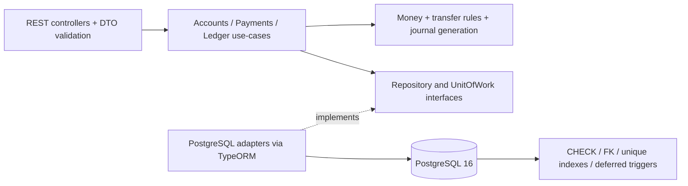
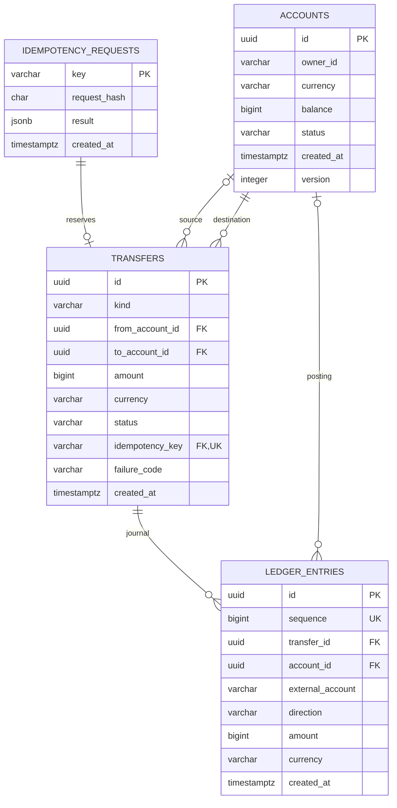

# payments-ledger-service

Учебно-портфолио сервис кошельков и переводов. Показывает обработку денег без потери точности, атомарные переводы, идемпотентность при гонках и проверяемый двойной журнал.

**Node.js 22 · TypeScript strict · NestJS 11 · PostgreSQL 16 · TypeORM 0.3 · Jest · Testcontainers.**

## Запуск в 3 команды

Нужен Docker Engine с Linux-контейнерами и Docker Compose v2. Из корня клонированного репозитория:

```sh
docker compose up --build -d --wait
docker compose exec app node dist/database/seed.js
curl http://localhost:3000/health/ready
```

Swagger UI: [http://localhost:3000/docs](http://localhost:3000/docs). Миграции выполняются до запуска приложения. Seed повторяемый: создаёт два RUB-счёта с балансом `100000` (1000 рублей) через обычные идемпотентные пополнения. Данные сохраняются в Docker volume. Первый запуск зависит от скорости загрузки образов.

Демо-сервис слушает только localhost. Авторизация и проверка принадлежности счёта не входят в этот репозиторий; перед внешним доступом нужны gateway с аутентификацией и проверка прав в use-case. Пополнение имитирует подтверждённое поступление средств: в настоящей системе его вызывает доверенный платёжный адаптер, а не клиент.

## Быстрая проверка

Примеры для sh/bash; в Windows используйте Git Bash или `curl.exe` с соответствующим экранированием JSON.

```sh
# Создание счёта с нулевым балансом
curl -s http://localhost:3000/api/v1/accounts \
  -H 'Content-Type: application/json' \
  -d '{"ownerId":"customer-charlie","currency":"RUB"}'

# Дополнительное пополнение Alice
curl -s http://localhost:3000/api/v1/accounts/11111111-1111-4111-8111-111111111111/deposit \
  -H 'Content-Type: application/json' -H 'Idempotency-Key: demo-deposit-1' \
  -d '{"amount":"5000","currency":"RUB"}'

# Alice -> Bob: 150 рублей
curl -s http://localhost:3000/api/v1/transfers \
  -H 'Content-Type: application/json' -H 'Idempotency-Key: demo-transfer-1' \
  -H 'X-Request-Id: demo-request-1' \
  -d '{"fromAccountId":"11111111-1111-4111-8111-111111111111","toAccountId":"22222222-2222-4222-8222-222222222222","amount":"15000","currency":"RUB"}'

# Баланс и журнал Alice
curl -s http://localhost:3000/api/v1/accounts/11111111-1111-4111-8111-111111111111
curl -s 'http://localhost:3000/api/v1/accounts/11111111-1111-4111-8111-111111111111/entries?limit=2'

# Подставьте id из ответа POST /transfers
curl -s http://localhost:3000/api/v1/transfers/TRANSFER_UUID
```

Повторите перевод с тем же ключом: вернётся тот же `201` и то же тело, включая `id` и `createdAt`. Поменяйте `amount`: получите `422 IDEMPOTENCY_CONFLICT`. Для новой операции используйте новый ключ. Балансы и суммы во всех JSON представлены строками.

## Архитектура



Модули `accounts`, `transfers`, `ledger`, `health`, `common`; инфраструктура отдельно в `database`. Доменные модели и правила не импортируют NestJS или TypeORM. Репозитории внедряются через символы; транзакционная сессия передаётся явно. TypeORM управляет пулом, транзакциями и миграциями; SQL в адаптерах написан явно и параметризован. Мапперы отделяют строки БД, доменные модели и HTTP-ответы. ORM entities намеренно не используются: это SQL-first адаптер TypeORM, без скрытых `save`/hooks и автоматического создания схемы.



## Транзакция и гарантии

1. DTO принимает только положительную каноническую строку суммы и ISO 4217 валюту; `Money` повторяет доменные проверки и ограничение signed bigint.
2. В `READ COMMITTED` резервируем глобально уникальный ключ через `INSERT ... ON CONFLICT DO NOTHING`. При гонке PostgreSQL ждёт конкурирующий commit. Следующий statement видит сохранённый результат. Хеш включает тип операции, UUID, сумму, валюту; порядок JSON-полей не влияет.
3. Блокируем все участвующие счета одним `SELECT ... ORDER BY id FOR UPDATE`, только затем создаём строки с FK к счетам. Остаток проверяется после блокировки.
4. Планируем оба баланса до записи. Обновляем их с `WHERE version = :expected`, увеличивая version. Создаём завершённый перевод и ровно две проводки. Сохраняем HTTP-результат под ключом в той же транзакции.
5. На commit отложенные constraint triggers проверяют парность, направление, счета, валюты, суммы и соответствие каждого баланса журналу. Любая ошибка откатывает всё, включая резервирование ключа.

`FAILED` фиксируется для бизнес-отказов существующих разных счетов; проводок нет, повтор воспроизводит отказ даже после пополнения. При отсутствующем счёте или переводе самому себе сохраняется только идемпотентный отказ — недопустимая строка не обходит FK/CHECK. Ошибки входного формата и инфраструктуры не кэшируются. `PENDING` предусмотрен моделью, но синхронный API не оставляет его после commit. Депозит хранится как `kind=DEPOSIT` с `fromAccountId=null`: дебет внешнего источника `external:funding`, кредит пользовательского счёта. [ADR о журнале](docs/adr/004-ledger-and-deposits.md).

Журнал и переводы запрещают UPDATE, DELETE, TRUNCATE. Валюта, владелец и идентификатор счёта неизменяемы. `balance >= 0`, `amount > 0`, FK и уникальные ключи проверяются БД. Владелец БД/superuser технически может отключить триггеры: это не защита от администратора. В промышленной среде migration-role отделяется от ограниченной runtime-role.

## API и ошибки

| Метод | Путь                           | Назначение                                 |
| ----- | ------------------------------ | ------------------------------------------ |
| POST  | `/api/v1/accounts`             | Новый счёт                                 |
| GET   | `/api/v1/accounts/:id`         | Счёт и строковый баланс                    |
| POST  | `/api/v1/accounts/:id/deposit` | Пополнение, обязательный `Idempotency-Key` |
| POST  | `/api/v1/transfers`            | Перевод, обязательный `Idempotency-Key`    |
| GET   | `/api/v1/transfers/:id`        | Результат операции                         |
| GET   | `/api/v1/accounts/:id/entries` | `limit` 1–100, `cursor`                    |
| GET   | `/health`, `/health/ready`     | Readiness с запросом PostgreSQL            |
| GET   | `/health/live`                 | Liveness без зависимости от БД             |

Cursor — непрозрачная base64url пара accountId/sequence. Порядок журнала убывает по sequence; следующий запрос использует `nextCursor`. Курсор привязан к счёту и валидируется. Страницы не являются MVCC-снимком на всё время обхода: новые записи проверяйте новым обходом с первой страницы; sequence отражает порядок выдачи ID, а не порядок commit конкурирующих транзакций.

Ошибки имеют `Content-Type: application/problem+json` (RFC 7807):

```json
{
  "type": "urn:payments-ledger:problem:insufficient_funds",
  "title": "Conflict",
  "status": 409,
  "code": "INSUFFICIENT_FUNDS",
  "detail": "The source account has insufficient funds",
  "instance": "/api/v1/transfers",
  "requestId": "demo-request-1"
}
```

`400` — DTO/UUID/заголовок/курсор; `404` — счёт или перевод; `409` — недостаточно средств, неактивный счёт, конфликт версии; `422` — конфликт ключа, валют, перевод себе или переполнение; `429` — лимит запросов; `503` — временная недоступность/SQL timeout (`Retry-After: 1`). После сетевой ошибки повторяйте исходный ключ: commit мог состояться.

Pino пишет JSON с безопасным `X-Request-Id` (или новым UUID), методом, путём без query и HTTP-статусом. Тела, заголовки авторизации, ключи идемпотентности и параметры SQL не логируются. Сырые ошибки драйвера не попадают клиенту и в логи.

## Локальная разработка и тесты

```sh
npm ci
cp .env.example .env
docker compose up -d postgres
npm run migration:run
npm run start:dev
```

```sh
npm run lint
npm test
npm run test:e2e
npm run build
npm run seed
```

E2E автоматически создают отдельный `postgres:16-alpine` через Testcontainers, применяют реальные миграции и удаляют контейнер. Нужен запущенный Docker; подмена БД SQLite/mocks и автоматический skip не применяются. Тесты не используют рабочую БД. Unit-порог доменного покрытия — >90% (порог CI 90%, фактическое покрытие проверяется Jest); HTML-отчёт `coverage/lcov-report/index.html`.

E2E проверяют успешный перевод, отказы, точность >2^53, повтор и конфликт ключей, 20 одновременных повторов, 100 параллельных переводов, 100 встречных переводов, конкурирующий перерасход, пагинацию, RFC 7807, корреляцию и SQL-защиту журнала. CI также собирает и запускает Compose, выполняет seed и readiness.

## Настройки и эксплуатация

Все переменные проверяются zod; пример — [.env.example](.env.example). Обязателен `DATABASE_URL`. Пароли в ошибках валидации не печатаются.

| Переменная                   | По умолчанию | Назначение                       |
| ---------------------------- | ------------ | -------------------------------- |
| `PORT`                       | 3000         | HTTP-порт                        |
| `DB_POOL_SIZE`               | 20           | Максимум соединений              |
| `DB_STATEMENT_TIMEOUT_MS`    | 10000        | Таймаут SQL statement            |
| `DB_LOCK_TIMEOUT_MS`         | 5000         | Таймаут ожидания блокировки      |
| `RATE_LIMIT` / `RATE_TTL_MS` | 120 / 60000  | Запросов с одного IP за интервал |
| `LOG_LEVEL`                  | info         | Уровень JSON-логов               |

HTTP ограничивает тело 16 KiB, время приёма заголовков 10 s, запроса 15 s, неактивность соединения 20 s. SQL-пул ограничен; незавершённые idle-транзакции закрываются через 15 s. SIGTERM/SIGINT запускают Nest shutdown hooks, HTTP закрывает приём запросов, TypeORM освобождает пул; Compose даёт 30 s. `init: true` передаёт сигналы, приложение работает непривилегированным пользователем с read-only FS.

Для нескольких реплик миграции должны выполняться отдельным deployment job; стартовая Compose-команда рассчитана на одну реплику. Throttler использует память процесса; для нескольких реплик нужен общий storage. `trust proxy` не включён: при работе за прокси явно настройте доверенные адреса, иначе лимит будет учитывать IP прокси. Пароль Compose предназначен для локальной демонстрации; production использует секреты, отдельные роли и TLS к БД.

## Проектные решения и компромиссы

- **bigint и Money.** IEEE 754 теряет целые после 2^53. Суммы в bigint и строках от HTTP до PostgreSQL; курс валют и дробные ставки отсутствуют. [ADR 001](docs/adr/001-money-bigint.md).
- **Блокировки плюс version.** При списании нужен актуальный остаток. Детерминированный захват всех счетов предотвращает цикл ожиданий; optimistic condition ловит нарушение контракта другими writers. [ADR 003](docs/adr/003-locking.md).
- **Двойная запись.** Каждое изменение имеет контрагента; баланс восстанавливается суммой CREDIT − DEBIT. Deferred triggers проверяют конечное состояние транзакции, а журнал append-only. Суммирование в SQL использует точный `numeric`, чтобы агрегат не переполнился; float не используется.
- **Сохранённая идемпотентность.** Ключи глобальны, без TTL: нельзя повторно исполнить старую платёжную команду. Цена — рост таблицы и необходимость регламента архивирования. Результат операции хранится, баланс в ответ не включён. [ADR 002](docs/adr/002-idempotency.md).
- **Проверка проекции в БД.** Сверка сумм журнала при каждом изменении даёт сильную гарантию, но стоимость растёт с историей счёта. Для большого оборота нужны измерения, секционирование/контрольные точки и отдельная reconciliation-задача. [ADR 004](docs/adr/004-ledger-and-deposits.md).
- **Явный SQL через TypeORM.** Нет synchronize, автогенерации схемы, неявного изменения связей и ORM-сущностей в use-cases. Миграции версионируются, SQL копируется в dist при сборке. Для зависимостей multer/glob закреплены исправленные транзитивные версии через overrides.

Далее: аутентификация и авторизация, подтверждённые внешние поступления, возвраты отдельными компенсирующими переводами, роли БД, лимиты клиентов, метрики/алерты/reconciliation, резервное копирование и проверка восстановления. Отправка `transfer.completed` в брокер описана в [docs/outbox.md](docs/outbox.md); outbox намеренно не реализован.

## Разработка

Husky запускает lint-staged перед коммитом и commitlint для Conventional Commits (`feat:`, `test:`, `docs:`, `chore:`, `fix:`). Lockfile фиксирует зависимости; `npm ci` воспроизводит установку. Лицензия MIT.
